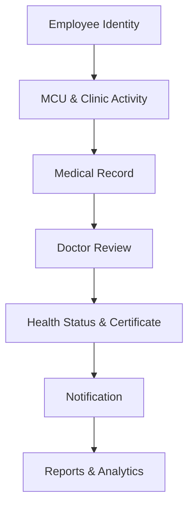
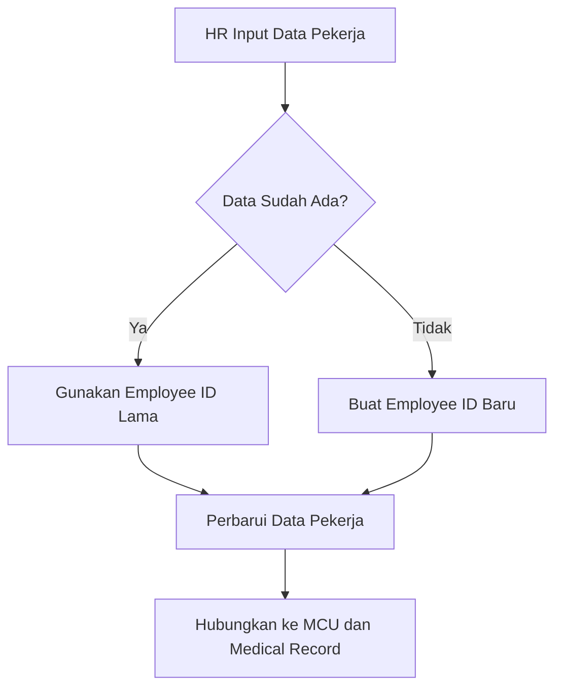
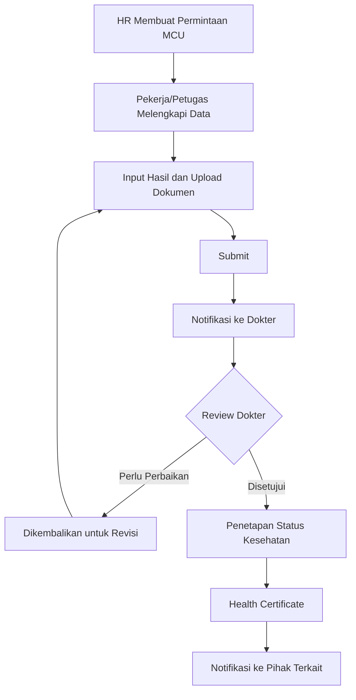
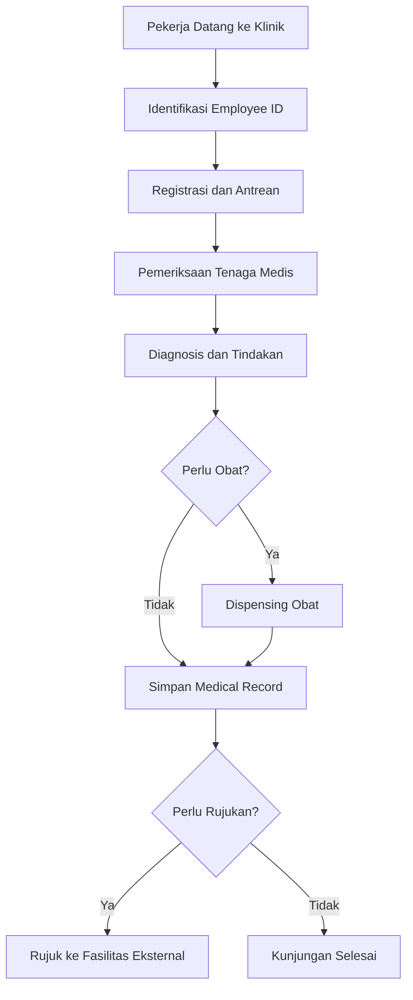
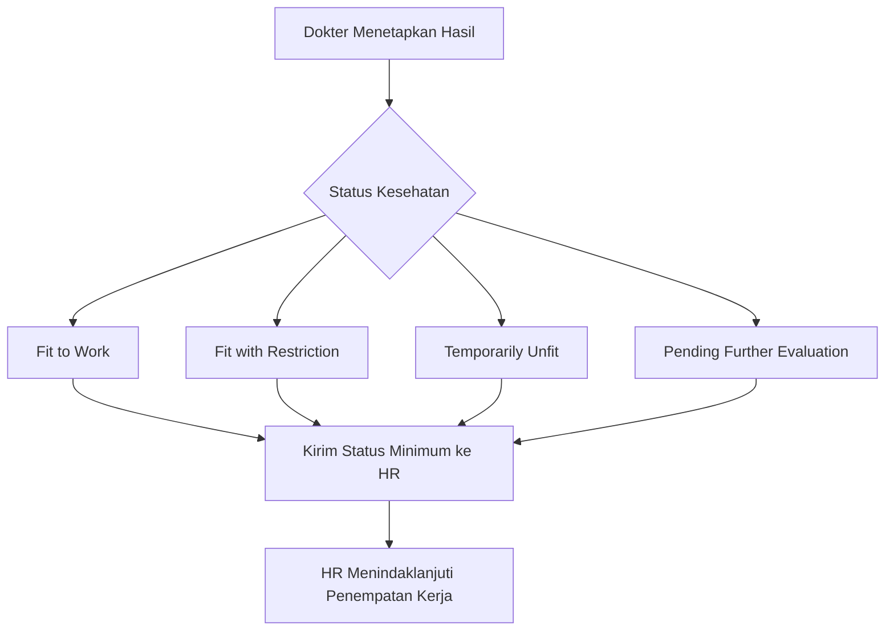
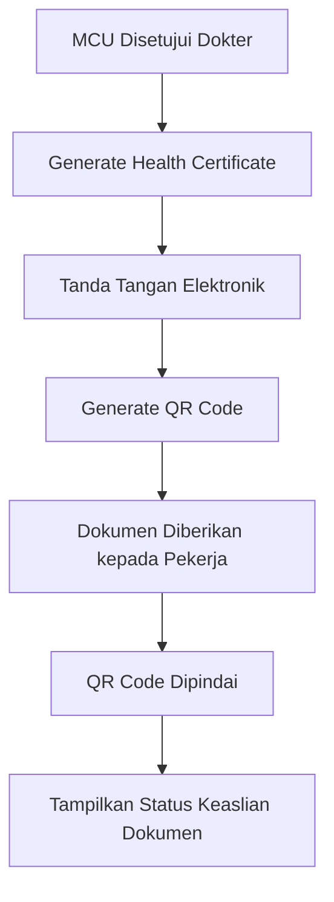
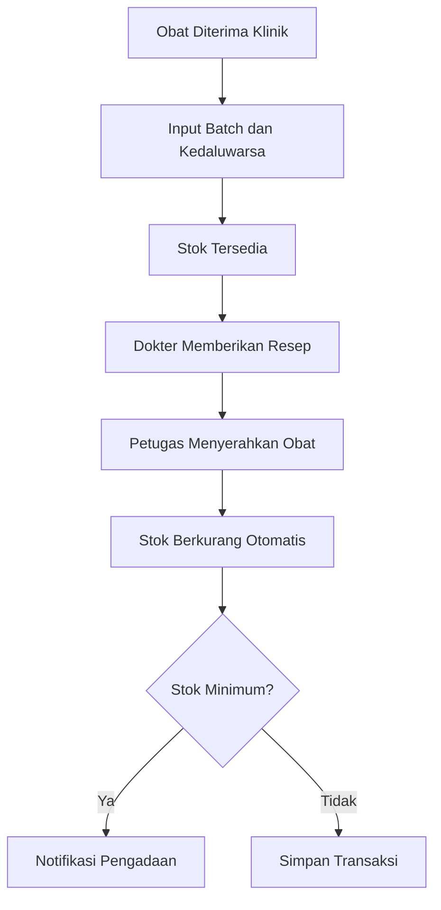
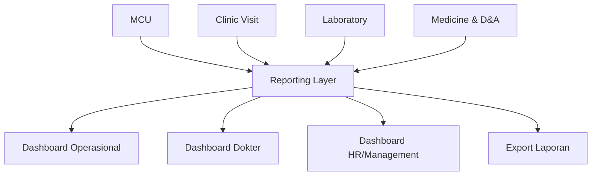

# Product Requirements Document (PRD)

## Demo Awal Occupational Health & Clinic Management App

| Informasi | Detail |
|---|---|
| Versi | 0.1 — Initial Demo |
| Status | Draft untuk validasi client |
| Tanggal | 22 September 2026 |
| Platform | Web application responsif |
| Target demo | Desktop dan tablet |
| Deployment demo | Development/Staging environment |

---

## 1. Ringkasan Produk

Kodein Klinik App adalah aplikasi web untuk mengelola identitas pekerja, Medical Check Up (MCU), kunjungan klinik, rekam medis, status kesehatan kerja, health certificate, persediaan obat, serta laporan kesehatan perusahaan.

Demo awal dibuat untuk memperlihatkan alur utama sistem kepada client sebelum masuk ke pengembangan penuh. Demo menggunakan data dummy dan berfokus pada validasi proses bisnis, kebutuhan pengguna, struktur halaman, serta batas akses informasi medis.

---

## 2. Tujuan Demo

Demo awal harus membantu client:

1. Memahami gambaran umum sistem dari input data sampai laporan.
2. Memvalidasi proses registrasi dan identitas tunggal pekerja.
3. Memvalidasi alur pengajuan MCU dan review dokter.
4. Memastikan batas informasi antara dokter, petugas klinik, dan HR.
5. Memvalidasi alur kunjungan klinik dan pencatatan rekam medis.
6. Memahami proses penerbitan dan verifikasi health certificate.
7. Memvalidasi alur stok serta dispensing obat.
8. Menyetujui kebutuhan awal dashboard dan laporan.

Demo ini belum dimaksudkan sebagai aplikasi production dan belum menggunakan data pasien sebenarnya.

---

## 3. Sasaran Keberhasilan Demo

Demo dinyatakan berhasil apabila client dapat:

- menjalankan satu skenario pekerja dari registrasi sampai health certificate;
- memahami perbedaan akses HR, dokter, petugas klinik, dan admin;
- menyetujui atau memberi koreksi terhadap delapan alur utama;
- mengidentifikasi field, status, dokumen, dan laporan yang masih kurang;
- menetapkan fitur yang masuk MVP dan fitur yang ditunda;
- memberikan persetujuan untuk melanjutkan ke desain UI final dan development.

---

## 4. Pengguna Utama

| Pengguna | Kebutuhan utama dalam demo |
|---|---|
| HR/Management | Mengelola data pekerja, membuat permintaan MCU, dan melihat status administratif |
| Dokter/Medical Reviewer | Mereview hasil MCU, menetapkan status kesehatan kerja, dan menandatangani sertifikat |
| Petugas Klinik/Perawat | Mendaftarkan kunjungan, mencatat pemeriksaan awal, tindakan, dan pemberian obat |
| Petugas Farmasi/Obat | Mengelola stok, batch, kedaluwarsa, dan dispensing |
| Admin Sistem | Mengelola akun, peran, lokasi, perusahaan, dan master data |
| Pekerja/Patient | Melihat profil, status proses MCU, dan dokumen yang diizinkan |
| Manajemen | Melihat dashboard agregat dan laporan tanpa mengakses detail medis yang tidak diperlukan |

---

## 5. Prinsip Produk

- **Single employee identity:** satu pekerja menggunakan satu nomor unik sepanjang siklus kerjanya.
- **Medical privacy by design:** informasi medis hanya terlihat oleh pengguna yang berwenang.
- **Minimum information for HR:** HR melihat status dan rekomendasi kerja, bukan seluruh diagnosis.
- **Traceable workflow:** setiap pengajuan, review, revisi, dan persetujuan memiliki riwayat.
- **Multi-location ready:** data dapat dipisahkan berdasarkan office, onshore, dan offshore.
- **Structured data first:** data utama disimpan dalam field terstruktur; dokumen hanya sebagai lampiran pendukung.
- **Role-based interface:** menu dan informasi disesuaikan dengan peran pengguna.

---

## 6. Ruang Lingkup Demo Awal

### 6.1 Termasuk dalam Demo

1. Login dengan beberapa role dummy.
2. Dashboard berbeda berdasarkan role.
3. Employee registration dan duplicate checking sederhana.
4. Employee profile dan riwayat kesehatan ringkas.
5. Pengajuan MCU, upload dokumen dummy, dan proses review.
6. Penetapan status kesehatan kerja.
7. Registrasi kunjungan klinik dan medical record sederhana.
8. Pemberian obat dan pengurangan stok otomatis.
9. Health certificate dengan QR verification dummy.
10. Dashboard laporan dan filter dasar.
11. Audit trail dasar pada perubahan status penting.

### 6.2 Di Luar Ruang Lingkup Demo

- integrasi langsung dengan HRIS, laboratorium, atau rumah sakit;
- notifikasi email/WhatsApp yang benar-benar dikirim;
- tanda tangan elektronik tersertifikasi;
- pembayaran, klaim asuransi, atau billing;
- migrasi data produksi;
- sinkronisasi offline untuk lokasi offshore;
- aplikasi mobile native;
- analitik prediktif;
- penggunaan data kesehatan nyata.

---

## 7. Struktur Navigasi Demo

### Menu Utama Admin

- Dashboard
- Employees
- MCU
- Clinic Visits
- Medical Records
- Medicine Stock
- Health Certificates
- Reports & Analytics
- Users & Roles
- Master Data
- Audit Logs

### Menu Utama Dokter

- Dashboard
- MCU Review Queue
- Patient Records
- Clinic Visits
- Health Certificates
- Medical Reports

### Menu Utama HR

- Dashboard
- Employees
- MCU Requests
- Work Health Status
- Administrative Reports

### Menu Utama Petugas Klinik

- Dashboard
- Patient Registration
- Queue
- Clinic Visits
- Medicine Dispensing

---

## 8. Flowchart 1 — Overall System Flow

### Tujuan

Memperlihatkan perjalanan data pekerja dari identitas hingga laporan manajemen.

### Kebutuhan Fungsional

| ID | Kebutuhan |
|---|---|
| OF-01 | Sistem menampilkan seluruh modul utama dalam satu navigasi terintegrasi. |
| OF-02 | Setiap transaksi medis harus terhubung dengan satu Employee ID. |
| OF-03 | Data dari MCU dan kunjungan klinik dapat digunakan dalam laporan sesuai hak akses. |
| OF-04 | Sistem menampilkan status proses pada setiap tahap. |
| OF-05 | Dashboard menyesuaikan informasi dengan role pengguna. |

### Layar Demo

- Login
- Role-based dashboard
- Employee profile
- MCU detail
- Clinic visit detail
- Reports dashboard

### Acceptance Criteria

- Pengguna berhasil login menggunakan akun dummy sesuai role.
- Setiap role melihat menu yang berbeda.
- Dari employee profile, pengguna berwenang dapat membuka MCU dan riwayat kunjungan pekerja yang sama.

---

## 9. Flowchart 2 — Employee Registration & Identity

### Tujuan

Memastikan setiap pekerja mempunyai satu identitas utama dan tidak dibuat berulang untuk MCU atau kunjungan berbeda.

### User Story

> Sebagai HR, saya ingin mendaftarkan pekerja dan memeriksa kemungkinan data ganda agar seluruh riwayat MCU dan kunjungan tersimpan pada identitas yang sama.

### Data Minimum

- Employee ID;
- nama lengkap;
- nomor identitas resmi;
- tanggal lahir;
- jenis kelamin;
- perusahaan;
- departemen;
- jabatan;
- lokasi kerja;
- tanggal mulai kerja;
- status pekerja;
- kontak;
- foto opsional.

### Kebutuhan Fungsional

| ID | Kebutuhan |
|---|---|
| EI-01 | HR dapat mencari pekerja berdasarkan Employee ID, nama, atau nomor identitas. |
| EI-02 | Sistem memperingatkan kemungkinan duplikasi sebelum data disimpan. |
| EI-03 | Employee ID dibuat otomatis atau diambil dari sistem sumber sesuai keputusan client. |
| EI-04 | Data pekerja dapat diperbarui tanpa menghapus riwayat lama. |
| EI-05 | Sistem menampilkan riwayat MCU, kunjungan, sertifikat, dan status kerja dalam employee profile. |
| EI-06 | Data pekerja dapat ditandai aktif, nonaktif, mutasi, atau kontrak selesai. |

### Layar Demo

- Employee list
- Add employee form
- Duplicate warning modal
- Employee profile
- Employment information tab
- Health timeline tab

### Acceptance Criteria

- Sistem menolak atau memperingatkan input nomor identitas yang sama.
- Pembuatan pekerja baru menghasilkan Employee ID unik.
- MCU baru dapat ditautkan ke pekerja yang sudah ada.
- Perubahan departemen tidak menghapus histori sebelumnya.

---

## 10. Flowchart 3 — MCU Submission & Doctor Review

### Tujuan

Mendigitalisasi proses permintaan, pengisian hasil, pengunggahan dokumen, review dokter, revisi, dan persetujuan MCU.

### User Stories

> Sebagai HR, saya ingin membuat permintaan MCU agar pekerja dapat diproses sesuai jadwal.

> Sebagai dokter, saya ingin melihat data dan dokumen MCU dalam review queue agar dapat menetapkan keputusan kesehatan kerja.

### Status MCU

`Draft → Submitted → Under Review → Revision Required → Resubmitted → Approved/Rejected → Closed`

### Data Minimum

- nomor MCU;
- Employee ID;
- jenis MCU;
- tanggal pemeriksaan;
- fasilitas pemeriksaan;
- hasil pemeriksaan terstruktur;
- lampiran dokumen;
- waiver bila diperlukan;
- reviewer;
- keputusan dan catatan;
- tanggal berlaku;
- riwayat status.

### Kebutuhan Fungsional

| ID | Kebutuhan |
|---|---|
| MCU-01 | HR dapat membuat permintaan MCU untuk satu pekerja. |
| MCU-02 | Petugas berwenang dapat mengisi hasil dan mengunggah dokumen. |
| MCU-03 | Sistem memvalidasi field dan dokumen wajib sebelum submit. |
| MCU-04 | Submission masuk ke review queue dokter. |
| MCU-05 | Dokter dapat menyetujui, menolak, atau meminta revisi disertai catatan. |
| MCU-06 | Revisi menghasilkan versi baru tanpa menghilangkan versi sebelumnya. |
| MCU-07 | Sistem menyimpan waktu dan pengguna pada setiap perubahan status. |
| MCU-08 | Notifikasi demo tampil di notification center tanpa harus mengirim email nyata. |

### Layar Demo

- MCU request form
- MCU list dan status filter
- MCU result form
- Document upload
- Doctor review queue
- Review detail dan decision panel
- MCU timeline/history

### Acceptance Criteria

- MCU yang belum lengkap tidak dapat disubmit.
- MCU yang disubmit muncul dalam review queue dokter.
- Dokter dapat meminta revisi dengan catatan wajib.
- Setelah disetujui, status kesehatan kerja dan tombol penerbitan sertifikat tersedia.

---

## 11. Flowchart 4 — Clinic Visit & Medical Record

### Tujuan

Mencatat perjalanan pasien sejak registrasi sampai kunjungan selesai atau dirujuk.

### User Story

> Sebagai petugas klinik, saya ingin mencatat kunjungan pekerja secara lengkap agar dokter dapat melihat riwayat dan tindak lanjutnya.

### Data Minimum

- nomor kunjungan;
- Employee ID;
- lokasi klinik;
- tanggal dan waktu;
- keluhan;
- pemeriksaan awal;
- diagnosis;
- tindakan;
- obat;
- catatan dokter;
- rujukan;
- status kunjungan.

### Kebutuhan Fungsional

| ID | Kebutuhan |
|---|---|
| CV-01 | Petugas dapat mencari pekerja menggunakan Employee ID. |
| CV-02 | Sistem membuat nomor kunjungan dan nomor antrean. |
| CV-03 | Tenaga medis dapat mencatat keluhan, pemeriksaan, diagnosis, dan tindakan. |
| CV-04 | Diagnosis dapat dipilih dari master ICD-10 demo. |
| CV-05 | Obat yang diberikan terhubung dengan kunjungan. |
| CV-06 | Kunjungan dapat ditutup atau diteruskan menjadi rujukan. |
| CV-07 | Riwayat kunjungan muncul pada employee health timeline. |

### Layar Demo

- Patient registration
- Queue board
- Clinical examination form
- Diagnosis selector
- Treatment and medicine section
- Referral form
- Visit summary

### Acceptance Criteria

- Nomor kunjungan dan antrean dibuat otomatis.
- Kunjungan tidak dapat ditutup sebelum field wajib dilengkapi.
- Obat yang diberikan muncul pada visit summary.
- Rujukan menyimpan fasilitas tujuan dan alasan rujukan.

---

## 12. Flowchart 5 — Health Status & HR Notification

### Tujuan

Menetapkan hasil kesehatan kerja dan memberikan informasi minimum yang diperlukan kepada HR tanpa membuka detail medis.

### User Stories

> Sebagai dokter, saya ingin menetapkan status kesehatan kerja beserta masa berlaku dan rekomendasinya.

> Sebagai HR, saya ingin melihat status kelayakan dan pembatasan kerja tanpa melihat diagnosis rahasia.

### Status Awal untuk Demo

- Fit to Work;
- Fit with Restriction;
- Temporarily Unfit;
- Pending Further Evaluation;
- Unfit.

### Kebutuhan Fungsional

| ID | Kebutuhan |
|---|---|
| HS-01 | Hanya dokter berwenang yang dapat menetapkan status kesehatan kerja. |
| HS-02 | Setiap status memiliki tanggal keputusan dan masa berlaku. |
| HS-03 | Restriction wajib memiliki rekomendasi, periode, dan tanggal review. |
| HS-04 | HR hanya melihat status, periode, rekomendasi kerja, dan tindak lanjut administratif. |
| HS-05 | Diagnosis dan catatan medis tidak muncul pada akun HR. |
| HS-06 | Perubahan status menghasilkan audit log. |

### Layar Demo

- Doctor decision form
- Work health status card
- HR status list
- Restriction detail
- Notification center

### Acceptance Criteria

- Akun dokter melihat data klinis lengkap sesuai kewenangan.
- Akun HR tidak dapat membuka diagnosis atau catatan dokter.
- Status dengan restriction tidak dapat disimpan tanpa periode dan rekomendasi.
- Perubahan status tampil dalam riwayat.

---

## 13. Flowchart 6 — Health Certificate & QR Verification

### Tujuan

Menerbitkan health certificate internal yang dapat diverifikasi keasliannya.

### Data Minimum Sertifikat

- nomor sertifikat;
- nama dan Employee ID;
- status kesehatan kerja;
- restriction bila boleh ditampilkan;
- dokter penerbit;
- tanggal terbit;
- masa berlaku;
- QR verification token;
- status valid, revoked, atau expired.

### Kebutuhan Fungsional

| ID | Kebutuhan |
|---|---|
| HC-01 | Sertifikat hanya dapat dibuat dari MCU yang sudah disetujui. |
| HC-02 | Sistem membuat nomor sertifikat unik. |
| HC-03 | Dokter melakukan konfirmasi tanda tangan elektronik demo. |
| HC-04 | QR code mengarah ke halaman verifikasi publik terbatas. |
| HC-05 | Halaman verifikasi tidak menampilkan diagnosis atau data medis rinci. |
| HC-06 | Sertifikat dapat ditandai revoked tanpa menghapus riwayat. |

### Layar Demo

- Certificate preview
- Sign confirmation modal
- Certificate list
- Public QR verification page

### Acceptance Criteria

- MCU yang belum disetujui tidak dapat menghasilkan sertifikat.
- QR code membuka halaman verifikasi sertifikat dummy.
- Halaman publik hanya menampilkan informasi minimum.
- Sertifikat yang revoked menampilkan status tidak berlaku.

---

## 14. Flowchart 7 — Medicine Stock & Dispensing

### Tujuan

Menghubungkan pemberian obat dengan kunjungan pasien dan memperbarui stok secara otomatis.

### User Story

> Sebagai petugas obat, saya ingin mencatat penerimaan dan dispensing agar stok setiap klinik selalu dapat dipantau.

### Kebutuhan Fungsional

| ID | Kebutuhan |
|---|---|
| MS-01 | Petugas dapat mencatat obat masuk berdasarkan lokasi, batch, dan tanggal kedaluwarsa. |
| MS-02 | Dispensing harus terhubung dengan kunjungan pasien. |
| MS-03 | Stok berkurang setelah dispensing dikonfirmasi. |
| MS-04 | Sistem mencegah jumlah dispensing melebihi stok tersedia. |
| MS-05 | Sistem menampilkan peringatan stok minimum dan kedaluwarsa. |
| MS-06 | Setiap pergerakan stok tersimpan dalam stock ledger. |

### Layar Demo

- Medicine master
- Stock by location
- Receive stock form
- Dispensing form
- Stock transaction ledger
- Low-stock alert

### Acceptance Criteria

- Penerimaan obat menambah stok lokasi yang dipilih.
- Dispensing mengurangi stok batch yang dipilih.
- Sistem menolak dispensing melebihi stok.
- Stok di bawah batas minimum menghasilkan alert pada dashboard.

---

## 15. Flowchart 8 — Reporting & Health Analytics

### Tujuan

Mengubah data operasional menjadi informasi yang relevan bagi klinik, dokter, HR, dan manajemen.

### Dashboard Demo

#### Dashboard Operasional

- jumlah kunjungan hari ini;
- jumlah pasien dalam antrean;
- MCU menunggu review;
- rujukan aktif;
- stok obat rendah;
- sertifikat segera kedaluwarsa.

#### Dashboard Dokter

- review queue;
- distribusi diagnosis;
- tren penyakit per periode;
- tindak lanjut medis;
- status MCU.

#### Dashboard HR/Management

- jumlah pekerja berdasarkan status kesehatan kerja;
- MCU jatuh tempo;
- restriction yang masih aktif;
- tren agregat berdasarkan perusahaan, departemen, dan lokasi;
- ringkasan aktivitas klinik.

### Kebutuhan Fungsional

| ID | Kebutuhan |
|---|---|
| RA-01 | Dashboard menampilkan data sesuai role pengguna. |
| RA-02 | Pengguna dapat memfilter periode, perusahaan, departemen, dan lokasi. |
| RA-03 | HR tidak dapat melakukan drill-down ke diagnosis individual. |
| RA-04 | Dokter dapat melihat tren klinis sesuai kewenangan. |
| RA-05 | Demo menyediakan tombol export yang menghasilkan file dummy atau preview. |
| RA-06 | Data agregat tidak boleh membuka informasi individu kepada pengguna yang tidak berwenang. |

### Layar Demo

- Operations dashboard
- Doctor dashboard
- HR/Management dashboard
- Report filter drawer
- Report preview

### Acceptance Criteria

- Perubahan filter memperbarui nilai kartu dan grafik demo.
- Dashboard berbeda untuk dokter dan HR.
- Pengguna HR tidak dapat membuka medical record melalui laporan.
- Laporan dapat ditampilkan dalam preview sebelum export.

---

## 16. Matriks Hak Akses Demo

| Fitur | Admin | Dokter | Klinik | Farmasi | HR | Pekerja | Manajemen |
|---|:---:|:---:|:---:|:---:|:---:|:---:|:---:|
| Kelola employee identity | ✓ | Lihat | Lihat | — | ✓ | Data sendiri | Agregat |
| Membuat permintaan MCU | ✓ | — | Opsional | — | ✓ | — | — |
| Input hasil MCU | ✓ | ✓ | ✓ | — | Terbatas | Opsional | — |
| Review MCU | — | ✓ | — | — | — | — | — |
| Melihat diagnosis | Terbatas | ✓ | ✓ | Terbatas | — | Data sendiri sesuai kebijakan | Agregat |
| Menetapkan health status | — | ✓ | — | — | — | — | — |
| Melihat work health status | ✓ | ✓ | ✓ | — | ✓ | Data sendiri | Agregat |
| Mengelola stok obat | ✓ | Lihat | Terbatas | ✓ | — | — | Agregat |
| Menerbitkan sertifikat | — | ✓ | — | — | — | — | — |
| Melihat laporan | ✓ | Klinis | Operasional | Obat | Administratif | — | Agregat |
| Kelola pengguna dan role | ✓ | — | — | — | — | — | — |

**Catatan:** Matriks ini merupakan rancangan awal dan harus divalidasi client.

---

## 17. Entitas Data Utama Demo

| Entitas | Relasi utama |
|---|---|
| Employee | Memiliki banyak MCU, kunjungan, dan sertifikat |
| Company | Memiliki departemen, lokasi, dan pekerja |
| Department | Memiliki pekerja |
| Work Location | Memiliki pekerja, kunjungan, dan stok |
| MCU | Dimiliki satu pekerja dan direview satu dokter |
| MCU Document | Dimiliki satu MCU |
| Work Health Status | Dihasilkan dari MCU/review dokter |
| Clinic Visit | Dimiliki satu pekerja dan satu lokasi |
| Medical Record | Dimiliki satu kunjungan |
| Diagnosis | Dapat digunakan dalam banyak medical record |
| Medicine | Memiliki banyak batch dan transaksi stok |
| Dispensing | Menghubungkan kunjungan dengan obat |
| Health Certificate | Dihasilkan dari MCU yang disetujui |
| Notification | Ditujukan kepada satu atau beberapa pengguna |
| Audit Log | Mencatat aksi penting pengguna |

---

## 18. Aturan Bisnis Utama

1. Satu nomor identitas resmi hanya dapat terhubung dengan satu Employee ID aktif.
2. Semua MCU dan kunjungan wajib terhubung dengan Employee ID.
3. MCU tidak dapat direview sebelum disubmit.
4. MCU tidak dapat disubmit jika field atau dokumen wajib belum lengkap.
5. Hanya dokter berwenang yang dapat menetapkan status kesehatan kerja.
6. HR tidak dapat melihat diagnosis, catatan klinis lengkap, atau hasil pemeriksaan rinci.
7. Health certificate hanya dapat diterbitkan dari MCU yang sudah disetujui.
8. Sertifikat yang telah diterbitkan tidak diedit langsung; koreksi membuat versi baru.
9. Dispensing harus terhubung dengan kunjungan dan stok yang tersedia.
10. Catatan medis tidak dihapus permanen melalui antarmuka normal.
11. Perubahan status penting wajib masuk audit log.
12. Data pada dashboard mengikuti role dan lokasi yang diberikan kepada pengguna.

---

## 19. Kebutuhan Nonfungsional Demo

### 19.1 Keamanan

- autentikasi berbasis akun dummy;
- role-based access control;
- session timeout simulasi;
- penyembunyian data sensitif berdasarkan role;
- audit log untuk aksi penting;
- tidak menggunakan data pasien nyata.

### 19.2 Kegunaan

- desain responsif untuk desktop dan tablet;
- navigasi konsisten;
- status ditampilkan menggunakan label dan warna yang mudah dibedakan;
- formulir dibagi menjadi beberapa bagian agar tidak terlalu panjang;
- validasi dan pesan error mudah dipahami;
- tombol aksi utama ditempatkan secara konsisten.

### 19.3 Performa Demo

- halaman utama ditargetkan tampil dalam maksimal 3 detik pada koneksi normal;
- pencarian data dummy memberikan hasil secara langsung;
- tabel menggunakan pagination;
- grafik menggunakan data sampel yang sudah disiapkan.

### 19.4 Auditability

Audit log minimum mencatat:

- pengguna;
- waktu;
- jenis tindakan;
- objek yang berubah;
- status sebelum dan sesudah;
- alasan perubahan bila diwajibkan.

---

## 20. Rancangan Data Dummy

Demo disarankan menggunakan:

- 30 pekerja;
- 3 perusahaan/unit;
- 5 departemen;
- 3 lokasi: office, onshore, dan offshore;
- 15 data MCU dengan berbagai status;
- 20 kunjungan klinik;
- 10 diagnosis contoh;
- 15 jenis obat;
- 5 sertifikat kesehatan;
- 4 akun utama: Admin, Dokter, Klinik, dan HR;
- 1 akun Manajemen dan 1 akun Pekerja sebagai tambahan.

Seluruh nama, nomor identitas, dan data kesehatan harus bersifat fiktif.

---

## 21. Skenario Demo kepada Client

### Skenario Utama

1. Login sebagai HR.
2. Cari pekerja berdasarkan nomor identitas.
3. Jika tidak ditemukan, buat Employee ID baru.
4. Buat permintaan MCU.
5. Lengkapi hasil dan unggah dokumen dummy.
6. Submit MCU dan lihat notifikasi.
7. Logout, lalu login sebagai dokter.
8. Buka review queue dan periksa pengajuan.
9. Minta revisi satu kali untuk memperlihatkan workflow.
10. Perbaiki data dan lakukan resubmit.
11. Dokter menyetujui MCU serta menetapkan Fit with Restriction.
12. Login sebagai HR dan tunjukkan bahwa HR hanya melihat status serta rekomendasi kerja.
13. Terbitkan health certificate dan buka halaman QR verification.
14. Daftarkan kunjungan klinik untuk pekerja yang sama.
15. Berikan obat dan tunjukkan pengurangan stok.
16. Buka dashboard laporan dan filter berdasarkan lokasi.

### Hasil yang Diharapkan

Client dapat melihat bahwa seluruh proses terhubung oleh Employee ID yang sama, tetapi informasi yang tampil tetap dibatasi berdasarkan role.

---

## 22. Pertanyaan Validasi Saat Demo

### Employee Identity

1. Apakah Employee ID dibuat sistem atau berasal dari sistem HR?
2. Identitas resmi apa yang wajib digunakan: KTP, SIM, paspor, atau kombinasi?
3. Bagaimana proses ketika pekerja pindah departemen, lokasi, atau perusahaan?

### MCU

4. Siapa yang menginput hasil MCU?
5. Apa saja jenis MCU dan field wajibnya?
6. Bagaimana alur waiver dan siapa yang menyetujuinya?
7. Apakah dokter boleh meminta pemeriksaan tambahan?

### Health Status

8. Status kesehatan kerja apa saja yang digunakan perusahaan?
9. Informasi apa yang boleh diterima HR?
10. Siapa yang menerima notifikasi untuk setiap status?

### Klinik dan Obat

11. Apakah setiap lokasi memiliki stok obat terpisah?
12. Apakah diperlukan transfer stok antar-lokasi?
13. Bagaimana alur rujukan dan tindak lanjut hasil rujukan?

### Certificate dan Reporting

14. Apakah health certificate hanya untuk internal perusahaan?
15. Informasi apa yang boleh terlihat pada halaman QR verification?
16. Laporan mana yang wajib tersedia saat go-live?

---

## 23. Deliverables Demo Awal

- prototype atau aplikasi web demo;
- akun dummy untuk setiap role;
- data dummy;
- delapan workflow utama;
- dashboard role-based;
- halaman QR verification;
- dokumen feedback client;
- daftar perubahan setelah demo;
- keputusan fitur MVP.

---

## 24. Definition of Done

Demo awal dinyatakan selesai apabila:

- delapan flowchart dapat dijalankan melalui antarmuka demo;
- semua layar utama dapat dinavigasi tanpa dead end;
- hak akses utama dapat diperlihatkan;
- data dummy terhubung secara konsisten;
- alur revisi dan persetujuan MCU dapat dijalankan;
- health certificate dan QR verification dapat didemonstrasikan;
- dispensing mengubah stok obat;
- dashboard merespons filter dasar;
- client memberikan catatan validasi;
- daftar keputusan dan perubahan pasca-demo terdokumentasi.

---

## 25. Tahap Setelah Demo

1. Rekap feedback dan keputusan client.
2. Revisi flowchart dan business rules.
3. Finalisasi scope MVP.
4. Susun wireframe dan UI design final.
5. Susun Software Requirements Specification (SRS).
6. Finalisasi ERD dan API specification.
7. Buat backlog, estimasi sprint, dan timeline.
8. Mulai development MVP setelah sign-off.

---

## 26. Persetujuan Awal

| Pihak | Nama | Keputusan | Tanggal | Catatan |
|---|---|---|---|---|
| Client Representative |  | Disetujui/Revisi |  |  |
| Medical Representative |  | Disetujui/Revisi |  |  |
| HR Representative |  | Disetujui/Revisi |  |  |
| Product/Project Lead |  | Disetujui/Revisi |  |  |

Dokumen PRD ini merupakan dasar demo awal dan masih dapat berubah setelah validasi bersama client.
