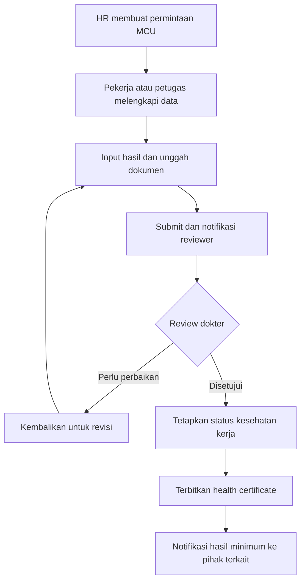

# Best Practice Summary Project

## Occupational Health & Clinic Management System

**Status dokumen:** Ringkasan awal kebutuhan proyek  
**Sumber:** Dua rekaman diskusi dan dua gambar catatan kebutuhan  
**Jenis solusi:** Aplikasi web berbasis cloud untuk pengelolaan kesehatan pekerja dan aktivitas klinik  
**Target pengguna:** Perusahaan dengan pekerja office, onshore, dan offshore serta klinik/first aid post di beberapa lokasi

---

## 1. Ringkasan Eksekutif

Proyek ini bertujuan membangun **Occupational Health & Clinic Management System** berbasis web yang menyatukan data identitas pekerja, hasil Medical Check Up (MCU), rekam medis dan kunjungan, aktivitas klinik, persediaan obat, hasil laboratorium, skrining Drug & Alcohol (D&A), sertifikat kesehatan, serta laporan analitik bagi manajemen.

Sistem dirancang untuk mendukung operasional perusahaan dengan lokasi kerja yang berbeda, yaitu **office, onshore, dan offshore**. Setiap pekerja memiliki satu identitas utama dan satu nomor unik yang digunakan secara konsisten sepanjang masa kerja, termasuk ketika menjalani MCU awal, MCU tahunan, berobat, menerima obat, atau mengikuti program kesehatan.

Prinsip utama sistem adalah:

- satu sumber data kesehatan pekerja yang konsisten;
- alur pemeriksaan dan persetujuan yang terdokumentasi;
- akses berbasis peran dan kebutuhan;
- perlindungan kerahasiaan data medis;
- dukungan pengambilan keputusan melalui laporan dan analitik;
- fleksibel untuk dikembangkan sesuai proses perusahaan.

---

## 2. Latar Belakang dan Permasalahan

Data kesehatan pekerja berpotensi tersebar dalam dokumen, berkas hasil MCU, catatan klinik, dan laporan manual dari beberapa lokasi. Kondisi ini dapat menyebabkan:

- riwayat kesehatan pekerja sulit ditelusuri secara lengkap;
- data MCU berkala tidak terhubung dengan identitas yang sama;
- proses review dokter dan penyampaian hasil belum terdokumentasi dalam satu alur;
- stok serta pengeluaran obat sulit dipantau secara real-time;
- laporan manajemen memerlukan rekap manual;
- tren penyakit berdasarkan lokasi, perusahaan, atau departemen sulit dianalisis;
- informasi medis berisiko dibagikan kepada pihak yang tidak berwenang.

Sistem yang diusulkan mengatasi permasalahan tersebut melalui basis data terpusat, workflow digital, notifikasi, audit trail, dan dashboard analitik.

---

## 3. Tujuan Proyek

1. Membangun basis data kesehatan pekerja yang terpusat dan terintegrasi.
2. Memastikan setiap pekerja mempunyai satu identitas unik yang tidak terduplikasi.
3. Mendigitalisasi proses MCU, waiver, review dokter, dan penerbitan health certificate.
4. Mencatat seluruh aktivitas klinik dan riwayat kunjungan secara kronologis.
5. Mengelola stok, penerimaan, pengeluaran, dan dispensing obat.
6. Menyediakan laporan operasional serta analitik kesehatan untuk manajemen.
7. Menyampaikan informasi status kelayakan kerja kepada pihak terkait tanpa membuka diagnosis atau data medis yang tidak diperlukan.
8. Mendukung pengelolaan beberapa klinik/lokasi dalam satu sistem.

---

## 4. Cakupan Organisasi dan Lokasi

Sistem diproyeksikan melayani beberapa titik layanan:

- **Office/Jakarta:** first aid post atau layanan kesehatan kantor;
- **Onshore:** klinik atau layanan kesehatan di lokasi operasi darat;
- **Offshore/Papua:** klinik di lokasi operasi lepas pantai;
- **Fasilitas rujukan eksternal:** rumah sakit atau laboratorium mitra ketika kasus tidak dapat ditangani di lokasi.

Setiap data transaksi wajib memiliki penanda lokasi agar laporan dapat difilter dan dibandingkan antar-site.

---

## 5. Pemangku Kepentingan dan Peran Pengguna

| Peran | Tanggung jawab utama | Batas akses yang disarankan |
|---|---|---|
| Super Admin | Konfigurasi sistem, organisasi, lokasi, peran, dan master data | Tidak otomatis melihat detail medis kecuali diberi kewenangan khusus |
| Dokter/Medical Reviewer | Review MCU, diagnosis, rekomendasi, fit-to-work, dan tanda tangan elektronik | Data medis pasien sesuai lingkup penugasan |
| Tenaga Klinik/Perawat | Registrasi kunjungan, pemeriksaan awal, tindakan, dan obat | Data klinis operasional sesuai lokasi |
| Petugas Laboratorium | Input atau unggah hasil pemeriksaan | Data pemeriksaan yang ditugaskan |
| Apoteker/Petugas Obat | Stok, penerimaan, dispensing, dan penyesuaian obat | Modul farmasi dan resep terkait |
| HR/Management | Mengelola identitas pekerja dan menerima status administratif | Hanya informasi minimum yang relevan, misalnya status fit, restriction, atau tindak lanjut; bukan diagnosis lengkap |
| Pekerja/Patient | Melihat data pribadi, jadwal, status proses, dan dokumen yang diizinkan | Hanya data miliknya sendiri |
| Auditor/Manajemen | Melihat laporan agregat dan audit sesuai kewenangan | Utamakan data agregat atau teranonimisasi |

---

## 6. Ruang Lingkup Fungsional

### 6.1 Employee Identity

- Satu nomor unik untuk setiap pekerja.
- Nomor unik terhubung dengan identitas resmi seperti KTP, SIM, atau paspor.
- Data dasar mencakup perusahaan, departemen, jabatan, lokasi, status kerja, dan periode kontrak.
- MCU awal, MCU tahunan, serta seluruh kunjungan menggunakan identitas yang sama.
- Sistem melakukan pemeriksaan duplikasi sebelum membuat data pekerja baru.
- Perubahan data personal disimpan dalam riwayat perubahan.

### 6.2 Medical Check Up (MCU) and Waiver

- Pembuatan permintaan MCU oleh pihak yang berwenang.
- Input hasil pemeriksaan secara terstruktur.
- Unggah dokumen pendukung atau hasil MCU dalam format file.
- Pengajuan waiver bila diperlukan.
- Submit data untuk proses review.
- Status proses yang jelas: **Draft → Submitted → Under Review → Revision Required/Approved/Rejected → Closed**.
- Notifikasi melalui email atau kanal yang disepakati.
- Review dokter beserta catatan dan keputusan.
- Penyampaian hasil review kepada pihak terkait sesuai hak akses.

### 6.3 Patient Administration and Queue Management

- Registrasi pasien dan pemilihan lokasi klinik.
- Nomor antrean, waktu kedatangan, prioritas, dan status layanan.
- Penugasan dokter atau tenaga klinik.
- Pencatatan rujukan ke fasilitas eksternal.
- Rekam waktu pelayanan untuk mengevaluasi waktu tunggu.

### 6.4 Medical Record and Visit History

- Riwayat kunjungan tersusun kronologis berdasarkan pekerja.
- Keluhan, pemeriksaan, diagnosis, tindakan, obat, rujukan, dan tindak lanjut.
- Klasifikasi diagnosis menggunakan **ICD-10** atau standar diagnosis yang disepakati.
- Lampiran hasil pemeriksaan dan dokumen pendukung.
- Catatan tidak dapat dihapus permanen tanpa jejak; koreksi dilakukan melalui amendment/versioning.

### 6.5 Medicine Stock Management and Dispensing

- Master obat, satuan, kategori, batch, tanggal kedaluwarsa, dan lokasi penyimpanan.
- Pencatatan stok masuk, stok keluar, penyesuaian, dan transfer antar-lokasi.
- Dispensing obat terhubung dengan kunjungan pasien.
- Peringatan stok minimum dan kedaluwarsa.
- Laporan penggunaan obat per periode, klinik, dan jenis obat.

### 6.6 Laboratory Result Management

- Pembuatan permintaan pemeriksaan laboratorium.
- Input hasil secara terstruktur dan/atau unggah dokumen.
- Penanda hasil di luar nilai rujukan.
- Review dan validasi hasil oleh tenaga berwenang.
- Hasil terhubung dengan kunjungan atau episode MCU yang sesuai.

### 6.7 Drug and Alcohol Screening Records and Reports

- Pencatatan jadwal, pelaksanaan, hasil, dan petugas pemeriksa.
- Dokumen pendukung dan status verifikasi.
- Hak akses khusus karena sifat data yang sensitif.
- Laporan agregat bagi manajemen tanpa membuka detail medis yang tidak diperlukan.

### 6.8 Clinic Activity and Wellness Program

- Pencatatan seluruh aktivitas klinik, termasuk kunjungan, tindakan, obat, rujukan, dan program wellness.
- Program kesehatan dapat ditautkan dengan kelompok pekerja, departemen, atau temuan risiko.
- Evaluasi dampak program berdasarkan tren sebelum dan sesudah intervensi.

### 6.9 Health Certificate

- Penerbitan health certificate setelah review dokter.
- Tanda tangan elektronik oleh dokter yang berwenang.
- QR code untuk verifikasi keaslian dokumen.
- Halaman verifikasi hanya menampilkan informasi minimum: nomor dokumen, nama/identitas yang diizinkan, status validitas, penerbit, dan tanggal berlaku.
- Dokumen yang dibahas merupakan sertifikat internal/non-certified; kedudukan dan penggunaannya perlu dikonfirmasi lebih lanjut.

### 6.10 Reports and Health Data Analysis

- Dashboard ringkas untuk operasional dan manajemen.
- Analisis berdasarkan individu, perusahaan, departemen, lokasi, diagnosis, dan periode.
- Tren penyakit dan kunjungan, misalnya kasus ISPA atau faktor risiko dari MCU.
- Statistik MCU, status fit-to-work, pembatasan kerja, follow-up, serta rujukan.
- Rekap pemakaian obat dan aktivitas klinik.
- Ekspor laporan sesuai format yang disepakati, misalnya PDF atau spreadsheet.
- Data agregat digunakan untuk merancang program pencegahan dan wellness.

### 6.11 Electronic Signature on All Records

- Tanda tangan elektronik pada dokumen yang memerlukan persetujuan.
- Identitas penanda tangan, waktu, versi dokumen, serta alasan persetujuan tercatat.
- Perubahan setelah penandatanganan harus membatalkan validitas versi lama dan membuat versi baru.

---

## 7. Alur Utama MCU dan Review

### Aturan penting alur

- Data tidak boleh masuk tahap review sebelum seluruh field wajib dan dokumen minimum tersedia.
- Reviewer tidak boleh mereview pengajuan yang dibuatnya sendiri apabila kebijakan organisasi mensyaratkan pemisahan tugas.
- Setiap perubahan status menyimpan waktu, pengguna, catatan, dan versi data.
- HR menerima keputusan administratif yang diperlukan untuk penempatan kerja, bukan seluruh informasi klinis.

---

## 8. Status Kesehatan Kerja yang Disarankan

Nilai status akhir harus dikonfirmasi oleh dokter dan kebijakan perusahaan. Sebagai rancangan awal, sistem dapat menyediakan:

- **Fit to Work**;
- **Fit with Restriction**;
- **Temporarily Unfit**;
- **Pending Further Evaluation**;
- **Unfit**.

Untuk setiap status selain Fit to Work, sistem perlu menyediakan masa berlaku, batasan kerja, tindak lanjut, dan tanggal review berikutnya tanpa membuka diagnosis kepada pihak yang tidak berwenang.

---

## 9. Data Utama dan Relasi Konseptual

| Entitas | Fungsi |
|---|---|
| Employee | Identitas tunggal pekerja |
| Company/Department/Position | Struktur organisasi dan segmentasi laporan |
| Work Location | Office, onshore, offshore, dan lokasi klinik |
| MCU Episode | Satu rangkaian MCU pada waktu tertentu |
| Waiver | Pengajuan pengecualian dan proses persetujuannya |
| Medical Visit | Episode kunjungan klinik |
| Medical Record | Detail klinis dari kunjungan atau MCU |
| Diagnosis | Kode dan deskripsi diagnosis terstandar |
| Laboratory Result | Hasil pemeriksaan laboratorium |
| Medication/Stock Transaction | Data obat dan pergerakan stok |
| Dispensing | Obat yang diberikan kepada pasien |
| D&A Screening | Rekam skrining Drug & Alcohol |
| Referral | Rujukan ke fasilitas eksternal |
| Health Certificate | Dokumen hasil review kesehatan kerja |
| Notification | Riwayat notifikasi dan penerima |
| Audit Log | Jejak aktivitas pengguna dan perubahan data |

---

## 10. Best Practice Arsitektur dan Implementasi

### 10.1 Arsitektur

- Aplikasi web responsif yang dapat digunakan melalui desktop, tablet, dan ponsel.
- Backend API terpisah dari antarmuka pengguna agar mudah dikembangkan dan diintegrasikan.
- Basis data relasional untuk menjaga konsistensi identitas, kunjungan, dan transaksi.
- Penyimpanan objek khusus untuk dokumen hasil MCU, laboratorium, dan sertifikat.
- Lingkungan terpisah untuk development, testing/staging, dan production.
- Deployment cloud; dalam diskusi disebutkan opsi **Microsoft Azure**, tetapi pilihan final perlu mempertimbangkan biaya, dukungan, lokasi data, dan kompetensi tim.
- Domain milik perusahaan digunakan pada production. Selama pengembangan dapat menggunakan subdomain sementara milik pengembang.

### 10.2 Integrasi

- Email untuk notifikasi workflow.
- QR code untuk verifikasi health certificate.
- API untuk integrasi HRIS, laboratorium, atau sistem lain pada fase lanjutan.
- Import data pekerja secara terkontrol untuk onboarding awal.
- Hindari integrasi langsung sebelum format data, pemilik data, dan sumber kebenaran ditetapkan.

### 10.3 Kinerja dan Ketersediaan

- Sistem tetap nyaman digunakan pada koneksi lokasi kerja yang terbatas.
- Gunakan kompresi dokumen, pagination, dan pemuatan data bertahap.
- Tetapkan target uptime, waktu respons, Recovery Time Objective (RTO), dan Recovery Point Objective (RPO) sebelum production.
- Pertimbangkan mekanisme antrean sinkronisasi/offline terbatas apabila konektivitas offshore tidak stabil.

---

## 11. Privasi, Keamanan, dan Tata Kelola Data

Data kesehatan adalah data sangat sensitif. Minimum control yang disarankan:

1. **Role-Based Access Control (RBAC):** akses diberikan berdasarkan peran, lokasi, dan kebutuhan kerja.
2. **Least privilege:** setiap pengguna hanya memperoleh akses minimum yang diperlukan.
3. **Multi-Factor Authentication:** wajib untuk dokter, admin, dan pengguna dengan akses sensitif.
4. **Enkripsi:** data terenkripsi saat dikirim dan saat disimpan.
5. **Audit trail:** login, lihat data, tambah, ubah, ekspor, tanda tangan, dan perubahan hak akses tercatat.
6. **Session security:** timeout, pembatasan percobaan login, dan pencabutan sesi.
7. **Segregation of duties:** fungsi input, review, persetujuan, dan administrasi dipisahkan bila diperlukan.
8. **Data minimization:** HR hanya menerima status dan rekomendasi kerja yang relevan.
9. **Backup dan restore:** backup terenkripsi serta uji pemulihan berkala.
10. **Retention dan disposal:** masa simpan serta pemusnahan data ditetapkan oleh perusahaan berdasarkan ketentuan yang berlaku.
11. **Consent dan notice:** pekerja mendapat penjelasan tentang tujuan, penggunaan, dan pihak yang dapat mengakses data.
12. **Incident response:** prosedur penanganan insiden dan pelaporan kebocoran harus tersedia sebelum go-live.

Kesesuaian terhadap kebijakan perusahaan dan regulasi perlindungan data serta layanan kesehatan yang berlaku harus diperiksa oleh pihak legal/compliance sebelum implementasi produksi.

---

## 12. Dashboard dan KPI yang Direkomendasikan

### Dashboard Operasional Klinik

- jumlah kunjungan hari ini;
- antrean dan waktu tunggu;
- kasus terbuka dan follow-up;
- rujukan;
- obat mendekati stok minimum atau kedaluwarsa;
- MCU yang menunggu review.

### Dashboard Medical/Doctor

- distribusi diagnosis berdasarkan ICD-10;
- tren penyakit per lokasi dan periode;
- pekerja dengan follow-up atau pemeriksaan lanjutan;
- status MCU dan masa berlaku sertifikat;
- pola risiko dari hasil MCU.

### Dashboard HR/Management

- jumlah pekerja berdasarkan status fit-to-work;
- MCU jatuh tempo atau kedaluwarsa;
- rekomendasi pembatasan kerja dan kebutuhan perubahan posisi;
- tren agregat berdasarkan perusahaan/departemen/lokasi;
- efektivitas program wellness;
- indikator layanan klinik tanpa membuka data klinis rinci.

---

## 13. Prioritas Pengembangan

### Fase 1 — Minimum Viable Product

- autentikasi, pengguna, dan role;
- master perusahaan, departemen, jabatan, dan lokasi;
- employee identity dan pemeriksaan duplikasi;
- MCU, unggah dokumen, waiver, workflow review, dan email notification;
- medical record serta visit history;
- health certificate, tanda tangan elektronik, dan QR verification;
- dashboard dasar dan audit log.

### Fase 2 — Operasional Klinik Lengkap

- administrasi pasien dan antrean;
- diagnosis ICD-10;
- laboratorium;
- medicine stock management dan dispensing;
- rujukan;
- D&A screening;
- laporan operasional yang dapat diunduh.

### Fase 3 — Analitik dan Integrasi

- dashboard tren lanjutan;
- analitik per perusahaan, departemen, dan lokasi;
- evaluasi program wellness;
- integrasi HRIS/laboratorium/sistem lain;
- dukungan konektivitas terbatas untuk lokasi offshore bila diperlukan.

---

## 14. Kriteria Penerimaan Tingkat Tinggi

Sistem dianggap memenuhi kebutuhan awal apabila:

- setiap pekerja memiliki satu nomor unik tanpa duplikasi;
- seluruh MCU dan kunjungan dapat ditelusuri dari identitas pekerja yang sama;
- pengajuan MCU dapat disubmit, direview, direvisi, disetujui, dan ditutup;
- notifikasi diterima oleh pengguna yang tepat;
- HR hanya melihat informasi yang sesuai kewenangannya;
- health certificate dapat diverifikasi melalui QR code;
- setiap perubahan data sensitif tercatat dalam audit trail;
- stok dan dispensing obat dapat direkonsiliasi;
- laporan dapat difilter berdasarkan periode, lokasi, perusahaan, serta departemen;
- dashboard menampilkan data sesuai role;
- backup dan restore berhasil diuji sebelum go-live.

---

## 15. Poin yang Masih Memerlukan Klarifikasi

1. Nama resmi perusahaan, domain yang akan digunakan, dan pemilik domain.
2. Jumlah pengguna, pekerja, lokasi, serta proyeksi pertumbuhan data.
3. Siapa yang menginput hasil MCU: HR, pekerja, tenaga medis, atau kombinasi ketiganya.
4. Field wajib, template hasil, dan dokumen minimum untuk setiap jenis MCU.
5. Definisi, kondisi, serta alur persetujuan waiver.
6. Daftar status fit-to-work dan otoritas yang boleh menetapkannya.
7. Informasi apa saja yang boleh dikirim kepada HR dan manajemen.
8. Bentuk serta kedudukan health certificate internal/non-certified.
9. Standar tanda tangan elektronik yang dibutuhkan.
10. Apakah notifikasi hanya melalui email atau juga melalui kanal lain.
11. Sistem sumber untuk data pekerja dan kebutuhan integrasi HRIS.
12. Detail alur pekerja yang kontraknya selesai, cuti sakit, mutasi, atau kembali bekerja.
13. Kebutuhan offline/sinkronisasi pada lokasi offshore.
14. Daftar laporan wajib dan format ekspornya.
15. Kebijakan retensi data, backup, dan pemulihan bencana.
16. Target waktu implementasi, anggaran, SLA, dukungan, dan pemeliharaan.

---

## 16. Risiko Proyek dan Mitigasi

| Risiko | Dampak | Mitigasi |
|---|---|---|
| Ruang lingkup terlalu luas pada fase awal | Waktu dan biaya membesar | Tetapkan MVP dan backlog prioritas |
| Data identitas pekerja ganda | Riwayat medis terpecah | Unique identifier, duplicate check, dan proses merge terkontrol |
| Akses HR terlalu luas | Pelanggaran kerahasiaan | Data minimization, RBAC, dan audit akses |
| Dokumen hasil MCU tidak seragam | Sulit dianalisis | Template terstruktur dan standardisasi field |
| Koneksi offshore tidak stabil | Layanan terganggu | Optimasi aplikasi dan opsi sinkronisasi terbatas |
| Migrasi data lama tidak bersih | Laporan tidak akurat | Data profiling, cleansing, mapping, dan uji migrasi |
| Perubahan workflow setelah development | Rework | Workshop proses dan persetujuan requirement sebelum sprint |
| Tanda tangan/sertifikat tidak dapat diverifikasi | Kepercayaan dokumen rendah | Versioning, QR verification, dan audit trail |

---

## 17. Rekomendasi Langkah Berikutnya

1. Lakukan workshop kebutuhan bersama dokter, HR, HSE, tenaga klinik, IT, dan perwakilan manajemen.
2. Validasi alur **as-is** dan susun alur **to-be** untuk MCU, kunjungan, obat, rujukan, serta pelaporan.
3. Tetapkan data dictionary, hak akses, dan klasifikasi kerahasiaan data.
4. Tentukan MVP serta backlog Fase 2 dan Fase 3.
5. Buat wireframe untuk dashboard, employee profile, MCU workflow, dan medical visit.
6. Susun Software Requirements Specification (SRS), acceptance criteria, serta estimasi proyek.
7. Bangun prototype dan lakukan user acceptance test dengan data dummy.
8. Lakukan security testing, uji backup-restore, pelatihan pengguna, dan pilot di satu lokasi sebelum rollout penuh.

---

## 18. Kesimpulan

Proyek ini bukan sekadar digitalisasi formulir klinik, melainkan pembangunan satu platform kesehatan kerja yang menghubungkan **identitas pekerja, layanan klinik, keputusan medis, kebutuhan operasional, dan analitik manajemen**. Keberhasilan sistem sangat bergantung pada standardisasi data, kejelasan batas akses, perlindungan data medis, serta implementasi bertahap berdasarkan prioritas.

Dokumen ini dapat digunakan sebagai bahan awal untuk discovery meeting, penyusunan proposal teknis, pembuatan SRS, perancangan database, dan estimasi biaya pengembangan.
